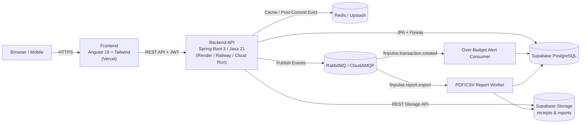

# FinPulse — Personal Finance & Expense Dashboard

**Live Application:** [https://finpulse.eshace.com](https://finpulse.eshace.com)

**FinPulse** is a full-stack personal finance and expense management platform built with **Angular 19**, **Spring Boot 3 (Java 21)**, **Supabase (PostgreSQL & Storage)**, **Redis**, and **RabbitMQ**. Designed with a Tactile Neo-Brutalist Kinetic UI, it helps individuals track income and expenses, attach receipt photos, enforce monthly category budgets with real-time over-budget alerts, analyze multi-month cashflow trends, and export monthly PDF/CSV financial reports asynchronously.

---

## Key Features

- **JWT Authentication & Refresh Token Rotation**: Secure registration, login, short-lived HMAC-SHA256 access tokens, rotating database-backed refresh tokens with pessimistic locking, and strict per-user data isolation across every private endpoint.
- **Transaction Management & Receipt Storage**: Full CRUD with server-side pagination, date range/type/category/search filtering, and receipt photo uploads (JPEG, PNG, WebP up to 5 MB with magic-byte validation) stored in **Supabase Storage**.
- **Monthly Budgets & Real-Time Over-Budget Alerts**: Category spending limits with real-time utilization progress bars (`Safe`, `Near Limit`, `Over Budget`) and asynchronous over-budget detection powered by **RabbitMQ** (`finpulse.transaction.created` consumer with unread alert deduplication).
- **Interactive Analytics Dashboard**: Asymmetric Bento Grid dashboard featuring 3D perspective wallet card, rolling odometer figures, a living SVG **FinPulse Vital** heartbeat widget driven by monthly burn ratio, 6-month cashflow bar chart, and category breakdown doughnut chart with custom external HTML tooltips.
- **Redis Caching & Post-Commit Invalidation**: Dashboard analytics cached in **Redis** (JSON serialization, configurable TTL) with per-user `TransactionSynchronization.afterCommit()` invalidation to prevent stale-read race conditions and automatic database fallback on cache outages.
- **Asynchronous PDF & CSV Report Exports**: Non-blocking monthly report generation via **RabbitMQ** (`finpulse.report.export`) using **OpenPDF** and RFC 4180 CSV (with CSV formula injection protection), uploaded to Supabase Storage with live frontend status polling.
- **Production SEO & Static Prerendering**: Public landing page at `/` prerendered at build time via Angular SSR/Prerender with dynamic Open Graph/Twitter cards, JSON-LD `SoftwareApplication` structured data, `robots.txt`, `sitemap.xml`, and `noindex` isolation for authenticated routes.

---

## Architecture Overview



### Tech Stack

| Layer | Technologies |
|---|---|
| **Frontend** | Angular 19 (Standalone Components, Signals, Reactive Forms), Tailwind CSS, Chart.js, Angular Animations, Static Prerendering (`@angular/ssr`) |
| **Backend** | Spring Boot 3.5 (Java 21), Spring Security + JJWT, Spring Data JPA, Flyway, Spring Data Redis, Spring AMQP, OpenPDF, Springdoc OpenAPI |
| **Database & Storage** | Supabase PostgreSQL (Flyway `V1`–`V3`), Supabase Storage (`receipts` & `reports` buckets) |
| **Caching & Messaging** | Redis 7 (local Docker / Upstash TLS), RabbitMQ 3.13 (local Docker / CloudAMQP TLS) |
| **Deployment** | Vercel (Frontend), Multi-stage Docker (`eclipse-temurin:21-jre-alpine`) for Render / Railway / Google Cloud Run |

---

## Repository Structure

```text
FinPulse/
├── backend/                  # Spring Boot 3 REST API, Flyway migrations, Dockerfile, 72 JUnit/MockMvc tests
├── frontend/                 # Angular 19 SPA + static prerendered landing page, vercel.json, 113 Karma specs
├── docs/
│   ├── api_contract.yaml     # OpenAPI 3.0.3 contract (source of truth)
│   ├── specs/                # Sprint 1–3 technical specifications
│   └── qa/                   # Sprint 1–3 QA & security audit reports
├── .agents/                  # Spec-driven multi-agent role definitions, skills, and sprint workflow
├── docker-compose.yml        # Local Redis & RabbitMQ with healthchecks
├── .env.example              # Environment variable template (no real secrets)
└── DEPLOY.md                 # Production deployment & SEO verification guide
```

---

## Local Quick Start

### Prerequisites
- **Java 21+** and **Maven 3.9+**
- **Node.js 20+** and **npm**
- **Docker** (for local Redis & RabbitMQ)
- A **Supabase** project (PostgreSQL connection string + public Storage buckets `receipts` and `reports`)

### 1. Configure Environment
Copy `.env.example` to `.env` in the repository root and fill in your Supabase credentials and a 32+ character `JWT_SECRET`:

```bash
cp .env.example .env
```

### 2. Start Local Redis & RabbitMQ
```bash
docker compose up -d
```

### 3. Run the Backend API
Spring Boot automatically imports `../.env` via `spring.config.import` and runs Flyway migrations (`V1`–`V3`):

```bash
cd backend
mvn spring-boot:run
```

### 4. Run the Frontend Web App
```bash
cd frontend
npm install
npm start
```

### Local Endpoints
- **Frontend**: `http://localhost:4200`
- **Backend API**: `http://localhost:8080`
- **Swagger UI (dev)**: `http://localhost:8080/swagger-ui.html`
- **RabbitMQ Management UI**: `http://localhost:15672`

For production deployment (Vercel + Render/Railway/Cloud Run + Upstash + CloudAMQP + DNS & SEO verification), see **[DEPLOY.md](DEPLOY.md)** and the OpenAPI contract in **[docs/api_contract.yaml](docs/api_contract.yaml)**.

---

## Spec-Driven & Agentic Engineering Workflow

FinPulse was engineered using an OpenAPI-first, multi-agent workflow defined in `.agents/`:

1. **Architect (`@architect`)**: Authors sprint specifications (`docs/specs/spec_sprint_<N>.md`) and updates the OpenAPI contract (`docs/api_contract.yaml`), stopping at a mandatory **Approval Gate** before any application code is written.
2. **Parallel Implementation (`@backend` & `@frontend`)**: Implements Spring Boot services and Angular standalone features strictly against the locked API contract.
3. **QA & Security Audit (`@qa`)**: Audits contract alignment, user-level data isolation, input/file/CSV/URL security, and Redis/RabbitMQ edge cases, documenting findings in `docs/qa/qa_report_sprint_<N>.md`.
4. **DevOps & Verification (`@devops`)**: Manages Docker, CI/local verification, and production deployment readiness.

**Automated Test Coverage: 185 passing tests**
- **Backend**: `72` JUnit 5 & MockMvc integration/unit tests (`mvn test`)
- **Frontend**: `113` Jasmine/Karma unit & component specs (`ng test --watch=false --browsers=ChromeHeadless`)
