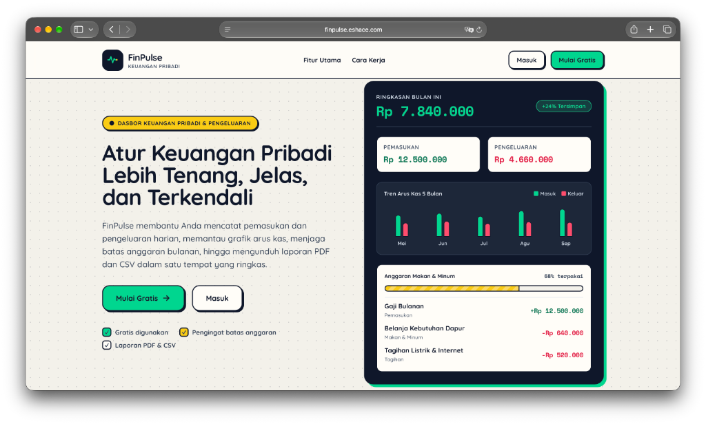
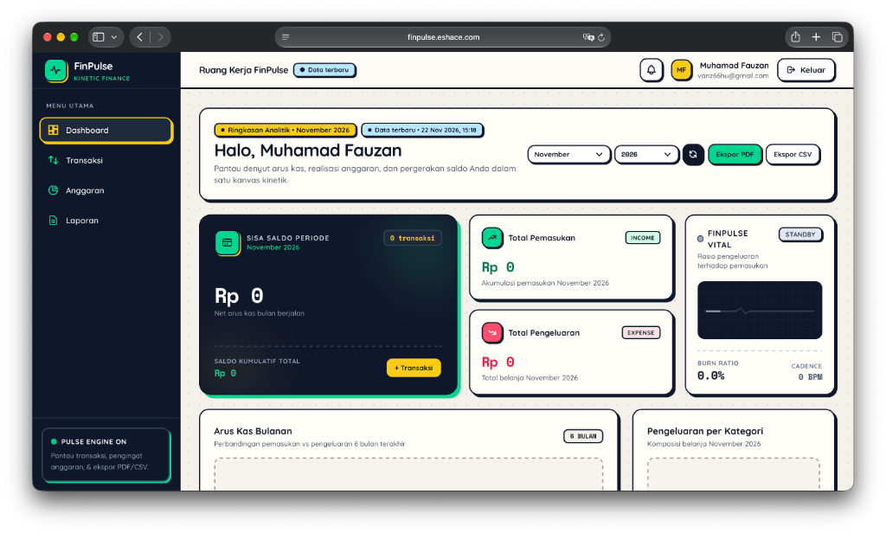
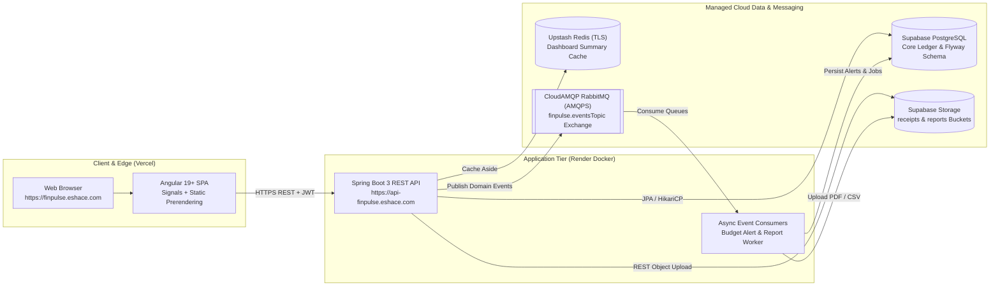

# FinPulse

**Track everyday income and expenses, visualize monthly cashflow, set smart category budgets, and export financial reports in one tactile workspace.**

### [**Live Application — https://finpulse.eshace.com**](https://finpulse.eshace.com)

---

## Product Preview

| Public Landing Page | Personal Finance Dashboard |
| :---: | :---: |
|  |  |

---

## Core Features

- **Real-Time Financial Pulse Dashboard** — View monthly net balance, total income, total expenses, six-month cashflow trends, and category spending breakdowns at a glance, accompanied by an adaptive financial health indicator.
- **Income & Expense Ledger with Receipt Attachments** — Record and filter transactions by period, type, category, or keyword search, and attach digital receipt photos directly to expense entries.
- **Category Budgets & Proactive Spending Alerts** — Set monthly spending limits per category with live utilization progress bars and receive automatic notifications when spending reaches warning (`80%`) or exceeded (`100%`) thresholds.
- **One-Click Monthly Report Exports** — Generate and download formatted monthly financial summaries in **PDF** or **CSV** complete with KPI totals, budget utilization, and itemized transactions.
- **Tactile Neo-Brutalist Responsive Interface** — High-contrast card hierarchy, smooth rolling numeric counters, keyboard-accessible custom controls, and seamless desktop-to-mobile responsiveness.

---

## System Architecture & Production Topology

| Layer | Technology | Production Platform |
| --- | --- | --- |
| **Frontend Web** | Angular 19+ (Standalone Components, Signals, Tailwind CSS, Chart.js, SSR Prerendering) | **Vercel** (`https://finpulse.eshace.com`) |
| **Backend API & Worker** | Spring Boot 3.5, Java 21, Spring Security JWT, Spring Data JPA, OpenPDF | **Render** — Multi-Stage Docker (`https://api-finpulse.eshace.com`) |
| **Primary Database** | PostgreSQL 17 with Flyway Versioned Schema Migrations (`V1`–`V3`) | **Supabase PostgreSQL** (`ap-southeast-1`) |
| **Object Storage** | Public Bucket Storage for Receipt Images (`receipts`) & Exported Reports (`reports`) | **Supabase Storage** |
| **Distributed Cache** | Redis Cache-Aside for Monthly Dashboard Aggregations | **Upstash Redis** (Serverless TLS) |
| **Message Broker** | AMQP Topic Exchange (`finpulse.events`) for Over-Budget Alerts & Report Generation | **CloudAMQP** (Managed RabbitMQ TLS) |

---

## Engineering Highlights

- **Contract-First OpenAPI 3.0 Design** — All REST endpoints, DTO schemas, validation constraints, and error envelopes are strictly governed by [`docs/api_contract.yaml`](docs/api_contract.yaml).
- **Versioned Database Migrations & Indexing** — Deterministic schema evolution via Flyway (`V1__init_schema.sql`, `V2__transactions_budgets.sql`, `V3__alerts_and_report_exports.sql`) with composite indexes and pessimistic write locking on token rotation.
- **Stateless JWT Security & Refresh Token Rotation** — Short-lived HMAC-SHA256 access tokens paired with database-backed refresh token rotation, automatic revocation, and strict per-user data isolation across every query.
- **Fault-Tolerant Redis Caching with Automatic Invalidation** — Dashboard aggregations are cached per user and period with deterministic eviction on any transaction or budget mutation and graceful database fallback on cache errors.
- **Event-Driven RabbitMQ Background Processing** — Transaction mutations and report export requests publish domain events after transaction commit (`afterCommit`) to dedicated queues for threshold alerting and asynchronous PDF/CSV generation.
- **Static Prerendering & Technical SEO** — Build-time prerendering for the public landing route (`/`), dynamic per-route title/meta tags, Open Graph & Twitter Cards, `robots.txt`, and `sitemap.xml`.
- **185 Automated Tests Passing** — **72** backend unit & MockMvc integration tests (JUnit 5, H2, Mockito) and **113** frontend unit tests (Jasmine & Karma Headless Chrome).
- **Spec-Driven Agentic Engineering Workflow** — Built through an orchestrated multi-role pipeline (`.agents/` — `@architect`, `@backend`, `@frontend`, `@qa`, `@reviewer`, `@devops`) backed by sprint specifications (`docs/specs/`) and QA/refactoring audit reports (`docs/qa/`).
