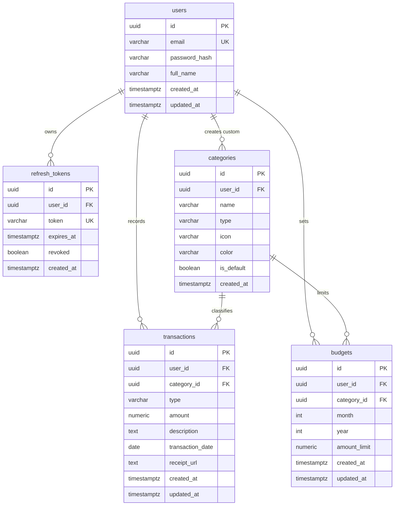

# Spesifikasi Teknis FinPulse — Sprint 1: Fondasi & Autentikasi

## 1. Tujuan & Exit Criteria Sprint 1

Sprint 1 berfokus pada pembangunan fondasi monorepo **FinPulse** (*Personal Finance & Expense Dashboard*), skema basis data PostgreSQL/Supabase awal via Flyway, sistem autentikasi JWT penuh pada backend Spring Boot 3, serta *shell* antarmuka web Angular 19+ yang responsif dan terhubung ke endpoint autentikasi.

### Exit Criteria
- [ ] Struktur monorepo terbentuk di `app_build/backend/` (`com.finpulse`) dan `app_build/frontend/` (`finpulse-web`).
- [ ] Migrasi Flyway `V1__init_schema.sql` valid untuk PostgreSQL/Supabase dan mencakup tabel `users`, `categories`, `transactions`, `budgets`, `refresh_tokens`, serta *seed* kategori bawaan.
- [ ] Seluruh konfigurasi sensitif (`SUPABASE_DB_URL`, `SUPABASE_DB_USER`, `SUPABASE_DB_PASSWORD`, `JWT_SECRET`, dll.) dieksternalisasi melalui environment variable (tanpa *hardcode*).
- [ ] Endpoint Sprint 1 berjalan sesuai `production_artifacts/api_contract.yaml`:
  - `POST /api/auth/register`
  - `POST /api/auth/login`
  - `POST /api/auth/refresh`
  - `POST /api/auth/logout`
  - `GET /api/auth/me`
  - `GET /api/categories`
- [ ] Spring Security memvalidasi JWT Bearer Token, menerapkan CORS untuk `http://localhost:4200`, dan mengembalikan format error JSON standar melalui `@RestControllerAdvice`.
- [ ] Frontend Angular 19+ menggunakan Standalone Components, Signals, Tailwind CSS, `authInterceptor`, `authGuard`/`guestGuard`, halaman Login & Register, serta Dashboard Shell (sidebar navigasi + daftar kategori default dari `/api/categories` + tombol logout).

---

## 2. Arsitektur & Struktur Direktori Monorepo

```text
app_build/
├── .env.example                          # Disiapkan di tahap DevOps/setup lokal
├── backend/                              # Spring Boot 3 (Java 21, Maven, artifactId: finpulse-api)
│   ├── pom.xml
│   └── src/
│       ├── main/
│       │   ├── java/com/finpulse/
│       │   │   ├── FinPulseApplication.java
│       │   │   ├── config/               # SecurityConfig, CorsConfig, OpenApiConfig, AppProperties
│       │   │   ├── controller/           # AuthController, CategoryController
│       │   │   ├── service/              # AuthService, JwtService, CategoryService
│       │   │   ├── repository/           # UserRepository, RefreshTokenRepository, CategoryRepository
│       │   │   ├── entity/               # User, RefreshToken, Category, Transaction, Budget, TransactionType
│       │   │   ├── dto/                  # RegisterRequest, LoginRequest, RefreshTokenRequest, AuthResponse, UserDto, CategoryDto
│       │   │   ├── security/             # JwtAuthenticationFilter, CustomUserDetailsService, SecurityUtils
│       │   │   └── exception/            # GlobalExceptionHandler, ErrorResponse, custom exceptions
│       │   └── resources/
│       │       ├── application.yml
│       │       └── db/migration/
│       │           └── V1__init_schema.sql
│       └── test/
│           └── java/com/finpulse/        # Unit & MockMvc integration tests
└── frontend/                             # Angular 19+ (Standalone, Signals, Tailwind CSS)
    ├── package.json
    ├── angular.json
    ├── tailwind.config.js
    └── src/
        ├── environments/
        │   └── environment.ts            # apiUrl: 'http://localhost:8080/api'
        └── app/
            ├── app.config.ts
            ├── app.routes.ts
            ├── core/
            │   ├── models/               # auth.model.ts, category.model.ts, error.model.ts
            │   ├── services/             # auth.service.ts, category.service.ts, toast.service.ts
            │   ├── interceptors/         # auth.interceptor.ts
            │   └── guards/               # auth.guard.ts, guest.guard.ts
            ├── features/
            │   ├── auth/
            │   │   ├── login/
            │   │   └── register/
            │   ├── dashboard/            # DashboardShellComponent
            │   ├── transactions/         # Placeholder route Sprint 2
            │   └── budgets/              # Placeholder route Sprint 2
            └── shared/
                └── components/           # AppLayoutComponent (Sidebar + Header), ToastComponent, SpinnerComponent
```

---

## 3. Skema Database & Migrasi Flyway (`V1__init_schema.sql`)

### Entity Relationship Diagram (Supabase / PostgreSQL)



### Definisi Tabel & Constraints (`V1__init_schema.sql`)

Migrasi awal membuat ekstensi `pgcrypto` (jika belum aktif untuk `gen_random_uuid()`) dan mendefinisikan 5 tabel utama:

1. **`users`**
   - `id UUID PRIMARY KEY DEFAULT gen_random_uuid()`
   - `email VARCHAR(255) NOT NULL UNIQUE`
   - `password_hash VARCHAR(255) NOT NULL`
   - `full_name VARCHAR(100) NOT NULL`
   - `created_at TIMESTAMPTZ NOT NULL DEFAULT NOW()`
   - `updated_at TIMESTAMPTZ NOT NULL DEFAULT NOW()`

2. **`categories`**
   - `id UUID PRIMARY KEY DEFAULT gen_random_uuid()`
   - `user_id UUID NULL REFERENCES users(id) ON DELETE CASCADE` (`NULL` menandakan kategori sistem bawaan yang dapat dibaca semua pengguna)
   - `name VARCHAR(100) NOT NULL`
   - `type VARCHAR(20) NOT NULL CHECK (type IN ('INCOME', 'EXPENSE'))`
   - `icon VARCHAR(50)`
   - `color VARCHAR(20)`
   - `is_default BOOLEAN NOT NULL DEFAULT FALSE`
   - `created_at TIMESTAMPTZ NOT NULL DEFAULT NOW()`
   - Indeks: `idx_categories_user_id` pada `(user_id)` dan `idx_categories_type` pada `(type)`.

3. **`transactions`** *(skema disiapkan sejak Sprint 1 untuk konsistensi ERD & relasi)*
   - `id UUID PRIMARY KEY DEFAULT gen_random_uuid()`
   - `user_id UUID NOT NULL REFERENCES users(id) ON DELETE CASCADE`
   - `category_id UUID NOT NULL REFERENCES categories(id) ON DELETE RESTRICT`
   - `type VARCHAR(20) NOT NULL CHECK (type IN ('INCOME', 'EXPENSE'))`
   - `amount NUMERIC(15, 2) NOT NULL CHECK (amount > 0)`
   - `description TEXT`
   - `transaction_date DATE NOT NULL`
   - `receipt_url TEXT`
   - `created_at TIMESTAMPTZ NOT NULL DEFAULT NOW()`
   - `updated_at TIMESTAMPTZ NOT NULL DEFAULT NOW()`
   - Indeks: `idx_transactions_user_date` pada `(user_id, transaction_date DESC)` dan `idx_transactions_user_category` pada `(user_id, category_id)`.

4. **`budgets`** *(skema disiapkan sejak Sprint 1)*
   - `id UUID PRIMARY KEY DEFAULT gen_random_uuid()`
   - `user_id UUID NOT NULL REFERENCES users(id) ON DELETE CASCADE`
   - `category_id UUID NOT NULL REFERENCES categories(id) ON DELETE CASCADE`
   - `month INT NOT NULL CHECK (month BETWEEN 1 AND 12)`
   - `year INT NOT NULL CHECK (year >= 2020)`
   - `amount_limit NUMERIC(15, 2) NOT NULL CHECK (amount_limit > 0)`
   - `created_at TIMESTAMPTZ NOT NULL DEFAULT NOW()`
   - `updated_at TIMESTAMPTZ NOT NULL DEFAULT NOW()`
   - Constraint unik: `uq_budgets_user_category_period UNIQUE (user_id, category_id, month, year)`.

5. **`refresh_tokens`**
   - `id UUID PRIMARY KEY DEFAULT gen_random_uuid()`
   - `user_id UUID NOT NULL REFERENCES users(id) ON DELETE CASCADE`
   - `token VARCHAR(512) NOT NULL UNIQUE`
   - `expires_at TIMESTAMPTZ NOT NULL`
   - `revoked BOOLEAN NOT NULL DEFAULT FALSE`
   - `created_at TIMESTAMPTZ NOT NULL DEFAULT NOW()`
   - Indeks: `idx_refresh_tokens_user_id` pada `(user_id)`.

### Seed Kategori Bawaan (`is_default = TRUE`, `user_id = NULL`)

| Nama Kategori | Tipe (`type`) | Icon | Warna (`color`) |
|---|---|---|---|
| Gaji | `INCOME` | `wallet` | `#10B981` |
| Investasi | `INCOME` | `trending-up` | `#059669` |
| Bonus | `INCOME` | `gift` | `#34D399` |
| Pemasukan Lainnya | `INCOME` | `plus-circle` | `#6EE7B7` |
| Makanan & Minuman | `EXPENSE` | `utensils` | `#F59E0B` |
| Transportasi | `EXPENSE` | `car` | `#3B82F6` |
| Belanja | `EXPENSE` | `shopping-bag` | `#8B5CF6` |
| Tagihan & Utilitas | `EXPENSE` | `receipt` | `#EF4444` |
| Hiburan | `EXPENSE` | `film` | `#EC4899` |
| Kesehatan | `EXPENSE` | `heart-pulse` | `#06B6D4` |

---

## 4. Spesifikasi Autentikasi, Keamanan & Error Handling (Backend)

### Alur JWT
1. **Password Hashing**: Menggunakan `BCryptPasswordEncoder` (strength default 10).
2. **Access Token**:
   - Ditandatangani dengan HMAC-SHA256 menggunakan `${JWT_SECRET}` (minimal 32 karakter / 256-bit).
   - Masa berlaku: **15 menit (900 detik)**, dapat dikonfigurasi via `JWT_ACCESS_EXPIRATION_MS` (default `900000`).
   - Claims: `sub` = `user.id` (UUID string), `email` = `user.email`, `fullName` = `user.fullName`, `iat`, `exp`.
3. **Refresh Token**:
   - Token acak kriptografis (UUID / Base64URL 64-byte) atau JWT refresh token unik yang disimpan di tabel `refresh_tokens` dengan masa berlaku **7 hari (604800 detik)** (`JWT_REFRESH_EXPIRATION_MS`, default `604800000`).
   - Endpoint `POST /api/auth/refresh` memvalidasi token di DB (`revoked = false` dan `expires_at > now()`), melakukan rotasi token (menandai token lama `revoked = true` dan menerbitkan pasangan access + refresh token baru).
   - Endpoint `POST /api/auth/logout` (terautentikasi Bearer JWT) menerima opsional `RefreshTokenRequest`; jika `refreshToken` dikirim, token tersebut dicabut (`revoked = true`), dan jika tidak dikirim atau untuk keamanan tambahan, seluruh refresh token aktif milik `userId` tersebut dicabut. Mengembalikan `204 No Content`.
4. **Isolasi Data Pengguna**:
   - `JwtAuthenticationFilter` mengekstrak `userId` dari access token dan menempatkan principal terautentikasi ke `SecurityContextHolder`.
   - Query `GET /api/categories` hanya mengembalikan kategori di mana `user_id IS NULL OR user_id = :currentUserId` (diurutkan `is_default DESC, name ASC`), dengan filter opsional `type` (`INCOME` / `EXPENSE`).
5. **CORS & Public Routes**:
   - Public endpoints: `POST /api/auth/register`, `POST /api/auth/login`, `POST /api/auth/refresh`, `/actuator/health`, `/v3/api-docs/**`, `/swagger-ui/**`, `/swagger-ui.html`.
   - Semua endpoint lain wajib terautentikasi (`401 Unauthorized` jika tanpa/invalid token).
   - Allowed origins: `${CORS_ALLOWED_ORIGINS:http://localhost:4200}`.

### Format Error JSON Standar (`@RestControllerAdvice`)

Setiap error mengembalikan struktur `ErrorResponse`:
```json
{
  "timestamp": "2026-11-21T11:00:00Z",
  "status": 400,
  "error": "Bad Request",
  "message": "Validasi input gagal",
  "path": "/api/auth/register",
  "validationErrors": {
    "email": "Format email tidak valid",
    "password": "Password minimal 8 karakter"
  }
}
```

Mapping HTTP status utama:
- `400 Bad Request`: Jakarta Bean Validation gagal (`MethodArgumentNotValidException`), tipe query parameter salah, atau JSON malformed.
- `401 Unauthorized`: Kredensial login salah, access token kedaluwarsa/tidak valid, atau refresh token tidak ditemukan/kedaluwarsa/dicabut.
- `409 Conflict`: Email sudah terdaftar saat registrasi (`EmailAlreadyExistsException`).
- `500 Internal Server Error`: Kesalahan tak terduga (tanpa membocorkan stack trace ke klien).

---

## 5. Daftar Komponen Frontend & Alur UI (Angular 19+)

### Desain & Identitas Visual FinPulse
- Palet fintech modern: *Slate Dark/Navy* untuk sidebar/branding (`#0F172A`), *Emerald* untuk aksen utama & pemasukan (`#10B981`), *Rose* untuk pengeluaran/peringatan (`#EF4444`), latar belakang bersih (`#F8FAFC`).
- Responsif untuk desktop dan mobile (sidebar dapat di-*toggle* pada layar kecil).

### Models & Core (`src/app/core/`)
- **Models**: `UserDto`, `RegisterRequest`, `LoginRequest`, `RefreshTokenRequest`, `AuthResponse`, `CategoryDto`, `TransactionType` (`'INCOME' | 'EXPENSE'`), `ErrorResponse` — cocok 100% dengan `api_contract.yaml`.
- **`AuthService`** (`core/services/auth.service.ts`):
  - State berbasis Angular Signals: `currentUser` (`signal<UserDto | null>`), `isAuthenticated` (`computed`), `isLoading` (`signal<boolean>`).
  - Penyimpanan token (`finpulse_access_token`, `finpulse_refresh_token`, `finpulse_user`) terenkapsulasi di service.
  - Metode: `register()`, `login()`, `refreshToken()`, `logout()`, `loadProfile()` (`GET /api/auth/me` saat inisialisasi jika token tersedia).
- **`authInterceptor`** (`core/interceptors/auth.interceptor.ts`):
  - Menyisipkan header `Authorization: Bearer <accessToken>` ke seluruh request API kecuali endpoint `/auth/login`, `/auth/register`, `/auth/refresh`.
  - Menangani `401 Unauthorized` dengan mencoba `refreshToken()` satu kali lalu mengulang request, atau melakukan logout & redirect ke `/login` jika refresh gagal.
- **Guards** (`core/guards/`):
  - `authGuard`: Melindungi rute internal (`/dashboard`, `/transactions`, `/budgets`). Redirect ke `/login` jika belum login.
  - `guestGuard`: Melindungi `/login` dan `/register`. Redirect ke `/dashboard` jika sudah login.

### Halaman & Fitur (`src/app/features/` & `src/app/shared/`)
1. **`LoginComponent` (`/login`)**:
   - Reactive Form (`email`, `password`) dengan validasi inline, *loading spinner* saat submit, dan *toast/alert* error dari backend.
   - Tautan navigasi ke `/register`.
2. **`RegisterComponent` (`/register`)**:
   - Reactive Form (`fullName`, `email`, `password`) dengan validasi panjang minimal nama (2 karakter) dan password (8 karakter).
   - Setelah sukses register (`201 Created`), otomatis menyimpan sesi dan mengarahkan pengguna ke `/dashboard`.
3. **`AppLayoutComponent`** (Shell Layout terautentikasi):
   - Sidebar navigasi **FinPulse**:
     - **Dashboard** (`/dashboard`) — aktif di Sprint 1.
     - **Transaksi** (`/transactions`) — halaman *coming soon* Sprint 2.
     - **Anggaran** (`/budgets`) — halaman *coming soon* Sprint 2.
   - Header menampilkan nama lengkap & email pengguna (`currentUser()`) serta tombol **Keluar (Logout)**.
4. **`DashboardShellComponent` (`/dashboard`)**:
   - Banner selamat datang personal untuk user yang sedang login.
   - 3 Kartu KPI *placeholder* (Total Pemasukan, Total Pengeluaran, Sisa Saldo) bertanda siap diisi data transaksi pada Sprint 2.
   - Bagian **Kategori Keuangan Tersedia**: memanggil `GET /api/categories` untuk memverifikasi alur end-to-end terautentikasi, lengkap dengan *loading skeleton*, *empty state*, dan pemisahan badge `INCOME` vs `EXPENSE`.
5. **`ToastComponent` & `SpinnerComponent`** (`src/app/shared/`): Notifikasi global untuk sukses/error login, register, logout, dan gagal memuat data.
