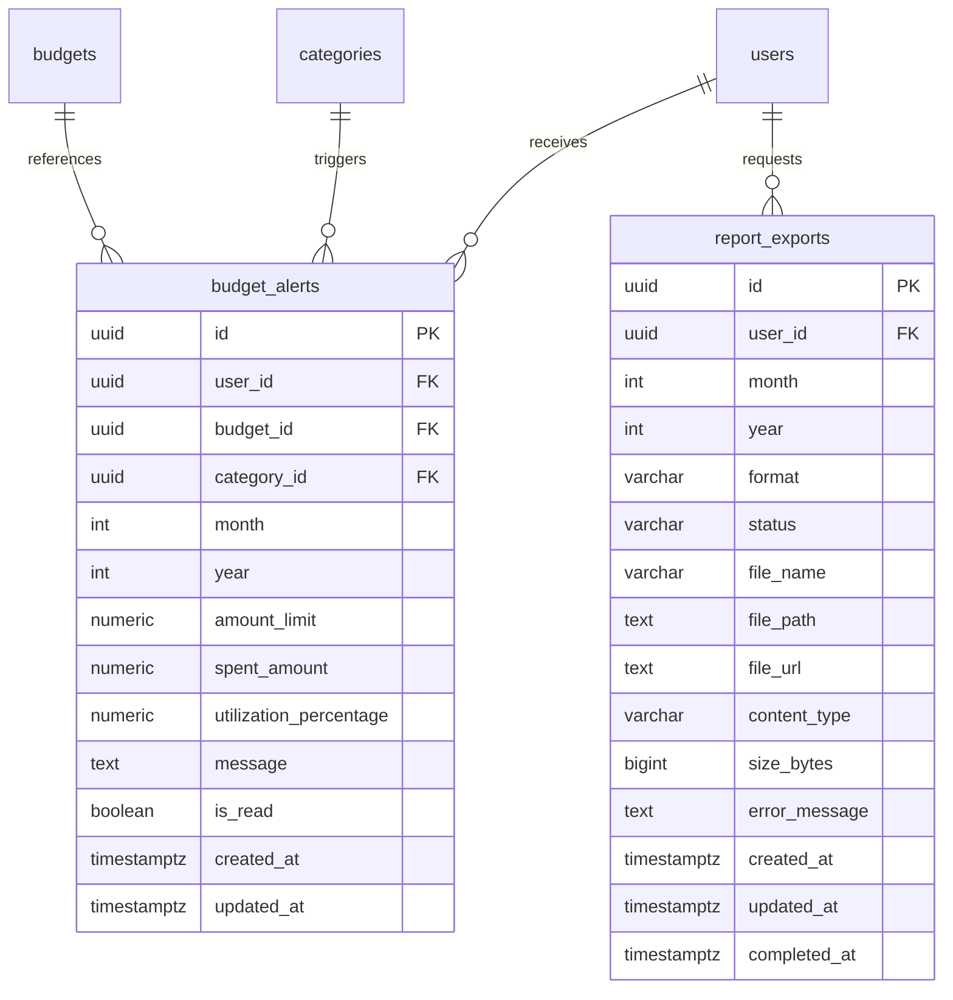

# Spesifikasi Teknis FinPulse — Sprint 3: Cache Redis, Event Asinkron RabbitMQ & Ekspor Laporan

## 1. Tujuan & Exit Criteria Sprint 3

Sprint 3 menyempurnakan **FinPulse** menuju arsitektur siap produksi dengan menambahkan *caching* ringkasan analitik dashboard menggunakan **Redis** beserta *auto-invalidation* aman dari *race condition*, pemrosesan event asinkron menggunakan **RabbitMQ** untuk deteksi *over-budget alert* secara otomatis dan *background job* ekspor laporan bulanan (**PDF/CSV**) ke **Supabase Storage**, konfigurasi **`docker-compose.yml`** lokal, serta fitur notifikasi, ekspor laporan, dan indikator sinkronisasi data di **Angular 19+**.

### Exit Criteria
- [ ] `app_build/docker-compose.yml` tersedia untuk menjalankan **Redis** (port `6379`) dan **RabbitMQ + Management UI** (port `5672` & `15672`) lengkap dengan *healthcheck* dan volume persisten.
- [ ] Migrasi Flyway `V3__sprint3_alerts_and_reports.sql` membuat tabel `budget_alerts` dan `report_exports` beserta constraint dan indeks.
- [ ] `GET /api/dashboard/summary` di-*cache* di Redis (`@Cacheable` pada `dashboardSummary`) dengan serializer JSON aman, TTL terkonfigurasi (`300` detik), *auto-invalidation* per `userId` pasca-commit transaksi/anggaran (`TransactionSynchronization.afterCommit`), fallback otomatis jika Redis tidak tersedia, serta metadata `generatedAt` & `fromCache` (+ header `X-Cache-Status: HIT|MISS`).
- [ ] Event `finpulse.transaction.created` dipublikasikan ke RabbitMQ pasca-commit setiap transaksi `EXPENSE` dibuat/diperbarui; consumer mendeteksi kondisi `spentAmount > amountLimit` dan menyimpan/memperbarui notifikasi di `budget_alerts` (terisolasi per `userId`).
- [ ] Antrean `finpulse.report.export` memproses permintaan ekspor bulanan (`POST /api/reports/export` -> `202 Accepted`) secara asinkron, menghasilkan file **PDF** (OpenPDF) atau **CSV** (RFC 4180 + proteksi *CSV formula injection*), mengunggah ke Supabase Storage bucket laporan (`${SUPABASE_REPORTS_BUCKET:reports}`), lalu memperbarui status job (`PENDING` -> `PROCESSING` -> `COMPLETED` / `FAILED`).
- [ ] Seluruh endpoint baru (`/api/alerts`, `/api/alerts/{id}/read`, `/api/alerts/read-all`, `/api/alerts/{id}`, `/api/reports/export`, `/api/reports`, `/api/reports/{id}`) mematuhi `production_artifacts/api_contract.yaml` (`3.0.0-sprint3`) dan isolasi `userId` penuh.
- [ ] Frontend Angular 19+ menyediakan **Panel Notifikasi Over-Budget** (badge unread + dropdown/panel di header + banner di Dashboard), halaman **Ekspor Laporan (`/reports`)** & shortcut ekspor PDF/CSV di Dashboard dengan *auto-polling* status sampai siap diunduh, serta **Indikator Status Sinkronisasi Data**.
- [ ] Pengujian otomatis (`mvn test`, `ng test --watch=false --browsers=ChromeHeadless`, `npm run build`) lulus tanpa memerlukan container Redis/RabbitMQ aktif saat test suite berjalan.

---

## 2. Skema Database & Migrasi Flyway (`V3__sprint3_alerts_and_reports.sql`)

### Entity Relationship Tambahan



### DDL Migrasi `V3__sprint3_alerts_and_reports.sql`
1. **`budget_alerts`**:
   - `id UUID PRIMARY KEY DEFAULT gen_random_uuid()`
   - `user_id UUID NOT NULL REFERENCES users(id) ON DELETE CASCADE`
   - `budget_id UUID NULL REFERENCES budgets(id) ON DELETE SET NULL`
   - `category_id UUID NOT NULL REFERENCES categories(id) ON DELETE CASCADE`
   - `month INT NOT NULL CHECK (month BETWEEN 1 AND 12)`
   - `year INT NOT NULL CHECK (year >= 2020)`
   - `amount_limit NUMERIC(15, 2) NOT NULL CHECK (amount_limit > 0)`
   - `spent_amount NUMERIC(15, 2) NOT NULL CHECK (spent_amount >= 0)`
   - `utilization_percentage NUMERIC(7, 2) NOT NULL`
   - `message TEXT NOT NULL`
   - `is_read BOOLEAN NOT NULL DEFAULT FALSE`
   - `created_at TIMESTAMPTZ NOT NULL DEFAULT NOW()`
   - `updated_at TIMESTAMPTZ NOT NULL DEFAULT NOW()`
   - Indeks: `idx_budget_alerts_user_created (user_id, created_at DESC)`, `idx_budget_alerts_user_read (user_id, is_read)`, `idx_budget_alerts_user_cat_period (user_id, category_id, year, month)`.

2. **`report_exports`**:
   - `id UUID PRIMARY KEY DEFAULT gen_random_uuid()`
   - `user_id UUID NOT NULL REFERENCES users(id) ON DELETE CASCADE`
   - `month INT NOT NULL CHECK (month BETWEEN 1 AND 12)`
   - `year INT NOT NULL CHECK (year >= 2020)`
   - `format VARCHAR(10) NOT NULL CHECK (format IN ('PDF', 'CSV'))`
   - `status VARCHAR(20) NOT NULL CHECK (status IN ('PENDING', 'PROCESSING', 'COMPLETED', 'FAILED'))`
   - `file_name VARCHAR(255)`
   - `file_path TEXT`
   - `file_url TEXT`
   - `content_type VARCHAR(100)`
   - `size_bytes BIGINT`
   - `error_message TEXT`
   - `created_at TIMESTAMPTZ NOT NULL DEFAULT NOW()`
   - `updated_at TIMESTAMPTZ NOT NULL DEFAULT NOW()`
   - `completed_at TIMESTAMPTZ`
   - Indeks: `idx_report_exports_user_created (user_id, created_at DESC)`, `idx_report_exports_user_status (user_id, status)`.

---

## 3. Strategi Cache Redis & Auto-Invalidation

### Dependensi & Konfigurasi
- Tambahkan `spring-boot-starter-cache` dan `spring-boot-starter-data-redis` di `pom.xml`.
- Konfigurasi `application.yml` (semua via env var):
  ```yaml
  spring:
    cache:
      type: ${SPRING_CACHE_TYPE:redis}
    data:
      redis:
        host: ${REDIS_HOST:localhost}
        port: ${REDIS_PORT:6379}
        password: ${REDIS_PASSWORD:}
        timeout: 2s

  finpulse:
    cache:
      dashboard-ttl-seconds: ${FINPULSE_CACHE_TTL_SECONDS:300}
  ```
- Pada `application-test.yml`: `spring.cache.type: simple` agar unit & integration test berjalan mandiri tanpa container Redis.

### Desain Key, Serialisasi, dan Pencegahan Race Condition
1. **Cache Name & Key Format**:
   - Cache name: `dashboardSummary` (prefix Redis: `finpulse:dashboardSummary::`).
   - Key format: `<userId>:<year>:<month>:<monthsBack>` (periode `month`/`year` diselesaikan terlebih dahulu oleh `PeriodResolver` sebelum memanggil bean `DashboardSummaryCacheService` yang dianotasi `@Cacheable`, menghindari key `null:null`).
2. **Serialisasi JSON Aman**:
   - `RedisCacheConfiguration` memakai `StringRedisSerializer` untuk key dan `Jackson2JsonRedisSerializer<>(objectMapper, DashboardSummaryDto.class)` (dengan `JavaTimeModule` aktif, tanpa `ObjectInputStream` / Java serialization).
   - TTL default: `300` detik (`5` menit), `disableCachingNullValues()`.
3. **Auto-Invalidation Anti Race-Condition & Terisolasi per User**:
   - Setiap mutasi data pada `TransactionService` (`createTransaction`, `updateTransaction`, `deleteTransaction`) dan `BudgetService` (`createBudget`, `updateBudget`, `deleteBudget`) memanggil `DashboardCacheInvalidator.evictAfterCommit(userId)`.
   - `evictAfterCommit(userId)` mendaftarkan callback pada `TransactionSynchronizationManager.registerSynchronization(afterCommit)` (jika dalam transaksi DB aktif; jika tidak, langsung eksekusi) sehingga *cache* baru dihapus **setelah** commit PostgreSQL terlihat oleh koneksi lain—mencegah *stale-read repopulation race condition*.
   - Penghapusan hanya menargetkan key milik `userId` tersebut (`SCAN` cursor dengan pola `*dashboardSummary::<userId>:*` di Redis; atau pembersihan prefix pada `ConcurrentMapCache` di mode `simple`), sehingga mutasi User A tidak pernah menggusur cache User B.
4. **Graceful Degradation & Cache Status Metadata**:
   - `CachingConfigurer.errorHandler()` menangkap kegagalan koneksi Redis (log warning tanpa mengembalikan `500`), sehingga permintaan dashboard tetap terlayani dari database.
   - `DashboardSummaryDto` menyertakan `generatedAt` (ISO-8601 timestamp saat agregasi dihitung) dan `fromCache` (`true` saat cache HIT, `false` saat cache MISS). `DashboardController` juga menyertakan header respons `X-Cache-Status: HIT | MISS` (ditambahkan ke `exposedHeaders` pada `SecurityConfig` CORS).

---

## 4. Arsitektur Queue & Event RabbitMQ

### Dependensi & Konfigurasi
- Tambahkan `spring-boot-starter-amqp` dan `com.github.librepdf:openpdf` (untuk generator PDF pure Java) di `pom.xml`.
- Konfigurasi `application.yml`:
  ```yaml
  spring:
    rabbitmq:
      host: ${RABBITMQ_HOST:localhost}
      port: ${RABBITMQ_PORT:5672}
      username: ${RABBITMQ_USERNAME:finpulse}
      password: ${RABBITMQ_PASSWORD:finpulse_dev}
      listener:
        simple:
          auto-startup: ${RABBITMQ_LISTENER_AUTO_STARTUP:true}
          default-requeue-rejected: false
          retry:
            enabled: true
            max-attempts: 3
            initial-interval: 1000ms
            multiplier: 2.0

  supabase:
    url: ${SUPABASE_URL:}
    service-key: ${SUPABASE_SERVICE_KEY:}
    storage-bucket: ${SUPABASE_STORAGE_BUCKET:receipts}
    reports-bucket: ${SUPABASE_REPORTS_BUCKET:reports}
  ```
- Pada `application-test.yml`: `spring.rabbitmq.listener.simple.auto-startup: false`.

### Topologi Exchange, Queue, & DLQ (`com.finpulse.messaging`)
- **Topic Exchange**: `finpulse.events` (durable = `true`)
- **Dead Letter Exchange (DLX)**: `finpulse.dlx` (DirectExchange, durable = `true`)
- **Serializer**: `Jackson2JsonMessageConverter` (payload JSON murni yang mudah diaudit di RabbitMQ Management UI).

| Queue | Routing Key | Dead Letter Queue | Publisher | Consumer |
|---|---|---|---|---|
| `finpulse.transaction.created` | `finpulse.transaction.created` | `finpulse.transaction.created.dlq` | `TransactionService` (pasca-commit transaksi `EXPENSE`) | `OverBudgetAlertConsumer` |
| `finpulse.report.export` | `finpulse.report.export` | `finpulse.report.export.dlq` | `ReportExportService` (pasca-commit job `PENDING`) | `ReportExportConsumer` |

### Alur Detail Worker Asinkron
1. **Over-Budget Alert (`OverBudgetAlertConsumer`)**:
   - Dipicu ketika transaksi bertipe `EXPENSE` dibuat (atau diperbarui menjadi `EXPENSE`). Event dikirim di `afterCommit` (jika broker RabbitMQ sedang tidak dapat dijangkau saat publish, log error tanpa membatalkan penyimpanan transaksi inti!).
   - Consumer memeriksa apakah terdapat `Budget` milik `userId` pada `(categoryId, month, year)`.
   - Jika ada, consumer menghitung `spentAmount` total pengeluaran kategori tersebut pada periode itu.
   - Jika `spentAmount > budget.amountLimit`:
     - Hitung `utilizationPercentage` (dibulatkan 2 desimal) dan bentuk pesan informatif (contoh: `"Pengeluaran kategori Makanan & Minuman pada Nov 2026 mencapai 115.00% dari batas anggaran."`).
     - Deduplikasi: jika sudah ada alert **belum dibaca** (`isRead = false`) untuk `(userId, categoryId, month, year)`, perbarui angka `spentAmount`, `amountLimit`, `utilizationPercentage`, `message`, dan `updatedAt`. Jika belum ada, buat baris baru di `budget_alerts`.

2. **Ekspor Laporan Bulanan PDF/CSV (`ReportExportConsumer`)**:
   - Klien memanggil `POST /api/reports/export` dengan `{ month, year, format }`.
   - Service membuat record `ReportExport` berstatus `PENDING` di DB, lalu setelah commit mengirim `ReportExportRequestedEvent` ke `finpulse.report.export` dan langsung membalas `202 Accepted` dengan `ReportExportDto`. Jika publikasi ke RabbitMQ gagal, job langsung ditandai `FAILED` dengan pesan ramah (tanpa membocorkan kredensial/stack trace) dan mengembalikan `503 Service Unavailable`.
   - Consumer membaca event:
     - Guard idempoten: jika job tidak ada atau sudah `COMPLETED`, abaikan.
     - Set `status = PROCESSING`.
     - Ambil data ringkasan periode + daftar seluruh transaksi user pada `(month, year)` + progres anggaran periode tersebut.
     - Generate dokumen:
       - **CSV**: UTF-8 (dengan BOM agar terbuka rapi di Excel), header & baris transaksi + ringkasan, *escaping* RFC 4180, serta sanitasi *CSV formula injection* (awalan `=`, `+`, `-`, `@`, `\t`, `\r` diberi prefiks `'`).
       - **PDF**: Menggunakan **OpenPDF** (`com.github.librepdf:openpdf`), berisi header FinPulse, periode laporan, ringkasan KPI (Total Pemasukan, Pengeluaran, Sisa Saldo), tabel progres anggaran, dan tabel rincian transaksi.
     - Unggah file ke Supabase Storage melalui `StorageService.uploadReport(userId, fileName, contentType, bytes)` pada bucket `${SUPABASE_REPORTS_BUCKET:reports}` dan path `<userId>/reports/<fileName>`.
     - Jika sukses: perbarui job menjadi `status = COMPLETED`, isi `fileName`, `filePath`, `fileUrl`, `contentType`, `sizeBytes`, `completedAt`.
     - Jika gagal (mis. Supabase Storage belum dikonfigurasi atau gagal jaringan): tangkap exception, perbarui job menjadi `status = FAILED` dengan `errorMessage` aman, `completedAt = now()`, tanpa requeue tak berujung.

---

## 5. Infrastruktur Lokal (`app_build/docker-compose.yml`)

File `app_build/docker-compose.yml` disiapkan di tahap `@devops`:
- **`redis`** (`redis:7-alpine`):
  - Port `${REDIS_PORT:-6379}:6379`
  - Command: `redis-server --appendonly yes`
  - Volume: `finpulse_redis_data:/data`
  - Healthcheck: `redis-cli ping`
- **`rabbitmq`** (`rabbitmq:3.13-management-alpine`):
  - Ports: `${RABBITMQ_PORT:-5672}:5672` (AMQP), `${RABBITMQ_MANAGEMENT_PORT:-15672}:15672` (Management UI)
  - Environment: `RABBITMQ_DEFAULT_USER=${RABBITMQ_USERNAME:-finpulse}`, `RABBITMQ_DEFAULT_PASS=${RABBITMQ_PASSWORD:-finpulse_dev}`
  - Volume: `finpulse_rabbitmq_data:/var/lib/rabbitmq`
  - Healthcheck: `rabbitmq-diagnostics -q ping`

---

## 6. Daftar Komponen Frontend & Alur UI (Angular 19+)

### Models & Services Baru (`src/app/core/`)
- **Models**:
  - `alert.model.ts`: `BudgetAlertDto`, `AlertListResponse`.
  - `report.model.ts`: `ReportFormat` (`'PDF' | 'CSV'`), `ReportStatus` (`'PENDING' | 'PROCESSING' | 'COMPLETED' | 'FAILED'`), `CreateReportExportRequest`, `ReportExportDto`.
  - Perbarui `dashboard.model.ts`: tambah `generatedAt: string` dan `fromCache: boolean` pada `DashboardSummaryDto`.
- **Services**:
  - `alert.service.ts`: Signal `alerts`, `unreadCount`, `isLoading`, metode `loadAlerts()`, `markAsRead(id)`, `markAllAsRead()`, `deleteAlert(id)`.
  - `report.service.ts`: `requestExport(req)`, `listExports(limit?)`, `getExport(id)`.
  - `sync-status.service.ts`: Signal `status` (`'idle' | 'syncing' | 'synced' | 'error'`), `source` (`'CACHE' | 'DATABASE' | null`), `lastSyncedAt` (`string | null`), metode `markSyncing()`, `markSynced(source, timestamp)`, `markError()`.

### Komponen & Halaman UI
1. **Panel Notifikasi Over-Budget (`src/app/shared/components/alert-panel/`)**:
   - Tombol lonceng dengan *unread badge* di header `AppLayoutComponent`.
   - Panel dropdown responsif berisi daftar notifikasi *over-budget* (nama kategori, periode, persentase utilitas, nominal terpakai vs batas, waktu), aksi **Tandai Dibaca**, **Tandai Semua Dibaca**, **Hapus**, serta *empty state* bersih.
   - `DashboardComponent` juga menampilkan banner peringatan ringkas saat ada notifikasi *over-budget* belum dibaca, dan menyegarkan daftar alert saat transaksi/anggaran baru dibuat atau diubah.
2. **Indikator Status Sinkronisasi Data (`AppLayoutComponent` & `DashboardComponent`)**:
   - Pill status real-time di header aplikasi & panel Dashboard yang menampilkan status sinkronisasi (`Menyinkronkan...`, `Tersinkron · Cache Redis`, `Tersinkron · Live DB`, atau `Gagal Sinkron`) beserta stempel waktu `generatedAt`.
3. **Halaman Ekspor Laporan Bulanan (`src/app/features/reports/reports.component.{ts,html,spec.ts}`)**:
   - Rute baru `/reports` (dilindungi `authGuard`) dan item navigasi **Laporan** di sidebar `AppLayoutComponent`.
   - Form ekspor: pemilih **Bulan**, **Tahun**, dan **Format** (`PDF` / `CSV`) + tombol **Buat Laporan**.
   - Tabel/daftar riwayat ekspor dengan badge status (`PENDING`, `PROCESSING`, `COMPLETED`, `FAILED`), **auto-polling setiap 2.5 detik** selama ada job `PENDING`/`PROCESSING` (berhenti otomatis saat seluruh job selesai atau komponen dihancurkan via `takeUntilDestroyed`), pesan error ramah saat `FAILED`, serta tombol **Unduh** (tautan disanitasi melalui `sanitizeHttpUrl()`).
   - Shortcut tombol cepat **Ekspor PDF** dan **Ekspor CSV** pada header `DashboardComponent` untuk langsung meminta laporan periode yang sedang ditampilkan lalu menyediakan tautan ke `/reports`.
